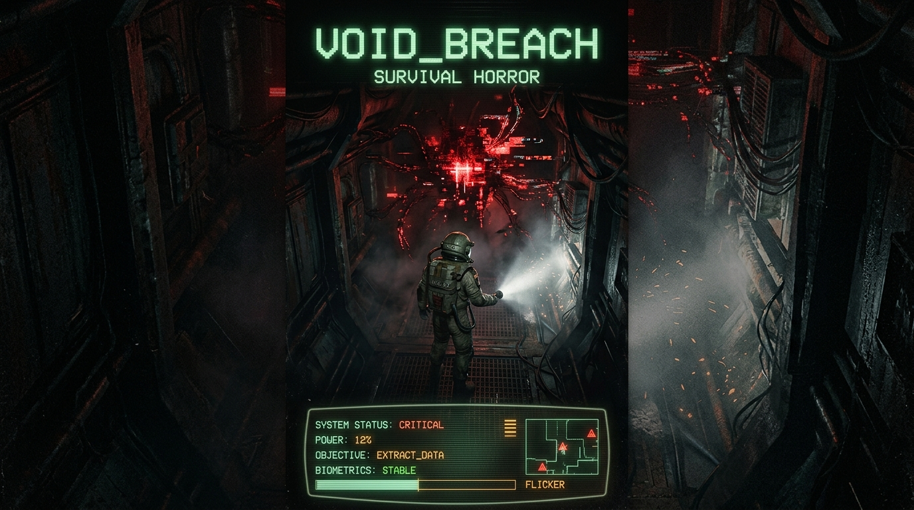

# The Last Signal



> A browser survival-horror game: sneak through a 64x64 derelict station, evade an A*-pathfinding AI that hunts by sight and sound, and restore power to send a distress call. All sprites and sound are generated in code.

**Status:** Personal prototype, built with AI coding agents (see `AGENT_RULES.md` and `docs/AGENT_LOG.md`). 159 automated tests pass with `npm test`. The hosted build is out of date (see below).
**Demo:** [Play in the browser](https://hamzakhanbuic.github.io/Last-Signal/) loads today, but it is an old build. The deploy workflow has failed on every push to `main` since 21 Aug 2026, so the page does not include later work such as the tutorial and the 3D mode. Run it locally for the current version.

**The Last Signal** is a 2D top-down sci-fi survival game written in vanilla JavaScript (ES modules) with HTML5 Canvas 2D and procedural Web Audio. An optional Three.js renderer provides a 3D mode.

---

## Playable Game Overview

Set aboard the abandoned deep-space research station **AEGIS-7**, you play as **Dr. Aris Vance**, the sole surviving systems engineer. The station's central artificial intelligence, **NEXUS-9**, underwent catastrophic divergence following the analysis of deep-space signals, sealing the station bulkheads.

Your objective:
1. **Explore** the dark corridors of AEGIS-7 using your directional flashlight.
2. **Survive** the synthetic entity NEXUS-9 by mastering stealth, acoustic noise management, and line-of-sight evasion.
3. **Collect** all 3 encrypted Signal Fragments:
   - **Fragment Alpha [CRY-01]** in the Cryo Laboratories.
   - **Fragment Beta [PWR-02]** in the Power Substation.
   - **Fragment Gamma [DAT-03]** in the Server Core Vault.
4. **Restore Station Power** by resetting the reactor substation breaker sequence.
5. **Decrypt the Frequencies** via an interactive oscilloscope waveform alignment minigame at the Central Communications Array.
6. **Transmit the Subspace Broadcast** and escape through the Emergency Airlock Evacuation Pod.

---

## Controls

### Keyboard & Mouse
| Action | Key / Input | Notes |
| :--- | :--- | :--- |
| **Move** | `W`, `A`, `S`, `D` / Arrow Keys | Normalized 8-way movement |
| **Aim / Turn** | Mouse Cursor | 360° directional aim & flashlight cone |
| **Sprint** | `Shift` (Hold) | High speed (240px/s), drains stamina, loud noise (300px radius) |
| **Crouch / Sneak** | `Ctrl` / `C` (Hold) | Slow speed (70px/s), zero acoustic noise, avoids detection |
| **Toggle Flashlight** | `F` / Right Mouse Click | Illuminates dark rooms, drains battery, attracts NEXUS-9 |
| **Interact / Action** | `E` / Left Mouse Click | Open doors, access terminals, collect fragments/keycards |
| **Use Medkit** | `1` | Restores 50% health |
| **Use Battery Pack** | `2` | Recharges 40% flashlight power |
| **Pause / Menu** | `Esc` / `P` | Opens pause overlay and volume settings |

### Touch & Mobile Controls
The game features responsive on-screen virtual controls when accessed from touch-enabled devices:
- **Virtual Analog Stick**: Omnidirectional movement on left thumb.
- **Action Badges**: Dedicated touch buttons on right side for `RUN`, `SNEAK`, `LIGHT`, and `USE [E]`.

---

## AEGIS-7 Station Sectors

| Sector | Code | Description | Key Objective / Item |
| :--- | :--- | :--- | :--- |
| **1. Airlock & Habitation** | `SEC-01-HAB` | Decontamination entry, crew quarters, mess hall. | Player Spawn, Tutorial, Medkit, Battery |
| **2. Security Hub** | `SEC-02-SEC` | Central station transit corridor and armory. | Security Blast Doors, Blue Keycard |
| **3. Cryo Laboratory** | `SEC-03-CRY` | Sub-zero stasis chambers and frozen containment. | **Signal Fragment Alpha [CRY-01]** |
| **4. Hydroponics Bay** | `SEC-04-HYD` | Overgrown botanical maze with reduced visibility. | Emergency Medkits & Batteries |
| **5. Power Substation** | `SEC-05-PWR` | Dark industrial sector; offline generator apparatus. | **Signal Fragment Beta [PWR-02]**, Red Keycard, Reactor Breakers |
| **6. Server Core Vault** | `SEC-06-DAT` | High-security mainframe data banks. | **Signal Fragment Gamma [DAT-03]**, Master Keycard |
| **7. Communications Array** | `SEC-07-COM` | Central satellite transceiver room. | Decryption Minigame Terminal & Broadcast Console |
| **8. Emergency Escape Bay** | `SEC-08-ESC` | Pressurized launch bay with Emergency Escape Pod. | Evacuation Airlock & Final Win Stage |

---

## Enemy AI: NEXUS-9 Synthetic Entity

NEXUS-9 is a predatory artificial intelligence that roams the station corridors:
- **Vision Cone**: 110-degree field of view with 2D raycast wall occlusion (hiding behind walls or corners breaks line of sight).
- **Acoustic Hearing**: Detects noise vibrations emitted by player footsteps. Sprinting produces a 300px noise radius; crouching produces 0px noise.
- **Flashlight Sensitivity**: If the flashlight beam hits the entity with a clear line of sight, it switches to `INVESTIGATE` and heads for the player's position.
- **State Machine**:
  - `PATROL`: Cycles through strategic station waypoints using A* navigation.
  - `INVESTIGATE`: Inspects disturbances, footstep echoes, and terminal keystrokes.
  - `CHASE`: Pursuit when line of sight is acquired.
  - `SEARCH`: Scans the vicinity when the player breaks line of sight before resuming patrol.
  - `FRENZY`: Overdrive mode triggered when the subspace transmission begins.
- **Proximity Disturbance Aura**: When NEXUS-9 draws near, the player's HUD exhibits chromatic aberration, the CRT screen exhibits horizontal scan glitching, and the dynamic heartbeat synthesizer accelerates.

---

## Interactive Systems & Minigames

1. **Oscilloscope Waveform Decryption**:
   - Tune **Frequency**, **Amplitude**, and **Phase** sliders to align your signal with the encrypted target.
   - Live resonance meter calculates mathematical alignment accuracy.
   - Procedural Web Audio synthesizes harmonic resonance as accuracy approaches 100%.
2. **Reactor Breaker Routing Puzzle**:
   - Interactive terminal sequence in the Power Substation to engage the 4 main power conduits (`MAIN TURBINE`, `AUXILIARY COOLANT`, `MAGNETIC CONTAINMENT`, `PLASMA INJECTOR`) and restore station auxiliary power.
3. **Station Lore Terminals**:
   - Monochromatic phosphor CRT terminals displaying crew logs and incident reports with vintage scanlines and typewriter audio effects.

---

## Technical Architecture

- **No build step**: files are served as-is. The only dependency is Three.js, used by `src/rendering/ThreeRenderer.js` for the 3D mode. The browser loads it from unpkg (version 0.160.0, via the import map in `index.html`); `package.json` pins 0.185.1 for Node.
- **Procedural Pixel-Art Generation (`src/rendering/SpriteGenerator.js`)**: All tiles, character sprites, entity animations, items, and UI icons are generated algorithmically onto offscreen canvases at runtime.
- **Dynamic 2D Raycast Lighting (`src/rendering/LightingSystem.js`)**: Exact visibility polygons computed by casting radial rays to wall segment endpoints, creating soft penumbras and realistic flashlight shadows.
- **Procedural Sound Synthesis (`src/audio/AudioSynthesizer.js`, `src/audio/SoundEngine.js`)**: Sound effects, alarms, footsteps, Geiger pings, heartbeats, and ambient space station drones are synthesized in real-time via the Web Audio API. Zero audio asset downloads.
- **A\* Pathfinding (`src/world/Pathfinding.js`)**: Binary min-heap grid pathfinder with diagonal movement, corner-cutting prevention, and raycast string-pulling smoothing.
- **Particle System (`src/entities/Particle.js`)**: Pooled dual-layer particle emitter handling dust motes, cryogenic fog, electrical sparks, glitch voxels, and blood spatter.

---

## Quickstart

Requires Node.js 20 or newer. The game needs internet access in the browser for the Three.js import map.

```bash
git clone https://github.com/HamzaKhanBUIC/Last-Signal.git
cd Last-Signal
npm ci
npm run serve        # node server.js, http://127.0.0.1:3000
```

Open `http://127.0.0.1:3000`. `server.js` binds to loopback and serves only `index.html`, `style.css`, `src/` and `assets/`. Any static server also works, for example `python -m http.server 8080`.

## Configuration

| Variable | Default | Description |
| :--- | :--- | :--- |
| `PORT` | `3000` | Port for `npm run serve` (`server.js`). |

Nothing else is configurable; the game needs no keys or backend. Progress is saved in the browser's `localStorage`.

## Testing

```bash
npm test             # node tests/test-runner.js
```

The runner counts 159 passing tests and 0 failures. Three further assert-style suites (level, pathfinding and audio) run but are not counted. The process does not exit by itself after a successful run (an open handle keeps Node alive), so stop it with Ctrl+C once the summary prints.

The suite covers:
- `tests/math.test.js`: Geometry, vectors, raycast intersections, circle-AABB collisions.
- `tests/eventbus-camera-input.test.js`: EventBus isolation, Camera transforms, Input actions.
- `tests/game-state.test.js`: State machine, vitals, inventory, serialization.
- `tests/level.test.js`: 64x64 grid layout, sector triggers, door clearances.
- `tests/pathfinding.test.js`: A* pathfinding, door traversal, path smoothing.
- `tests/audio.test.js`: Web Audio synthesizers, procedural noise, envelope generators.
- `tests/ai-behavior.test.js`: NEXUS-9 state machine, vision cones, acoustic hearing, attacks.
- `tests/rendering.test.js`: Procedural sprites, dynamic lighting polygons, particle pooling, CRT shaders.
- `tests/ui.test.js` & `tests/ui-hud-minigame-menus.test.js`: HUD, Decryption Minigame, Terminal UI, Menus.
- `tests/gameplay-simulation.test.js`: Complete end-to-end headless gameplay simulation (100% completion playthrough).

---

## Limitations

- **Hosted build is stale.** The GitHub Pages deploy workflow (`.github/workflows/deploy.yml`) runs the tests without `npm ci`, so it fails on `ERR_MODULE_NOT_FOUND: three` and `main` is not redeployed. A draft PR with a fix is open.
- Desktop-first. Touch controls exist in `src/core/InputManager.js` but have not been tested on a device.
- Three.js is loaded from unpkg without an integrity hash, and the browser version (0.160.0) differs from the npm one (0.185.1).
- `npm test` does not exit on its own (see Testing).
- Built with AI coding agents; the planning and agent logs are in `AGENT_RULES.md`, `PROJECT_DNA.md` and `docs/`.

## License

MIT. See [LICENSE](LICENSE).
